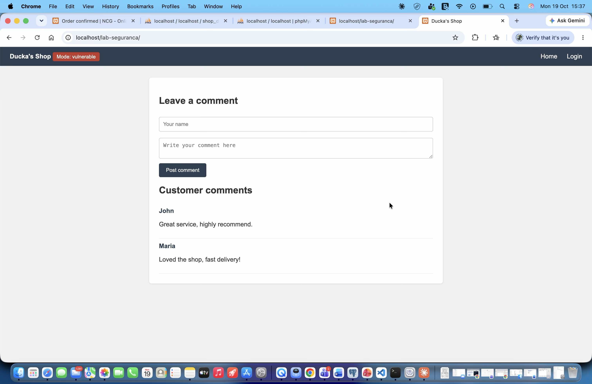
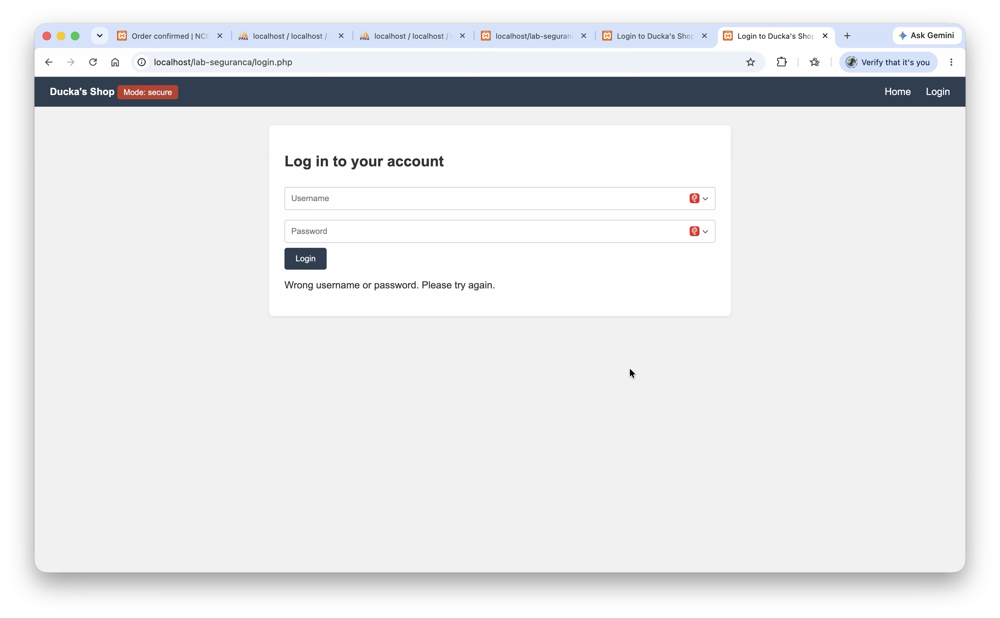
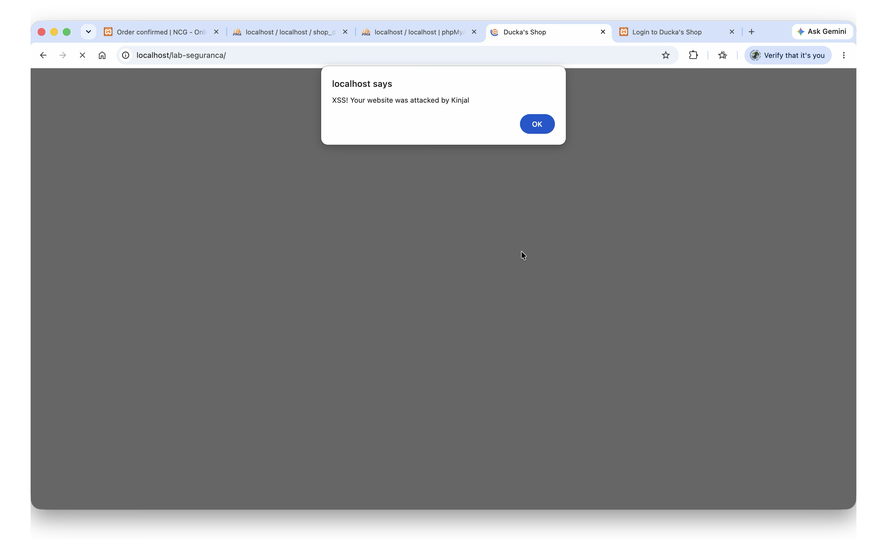
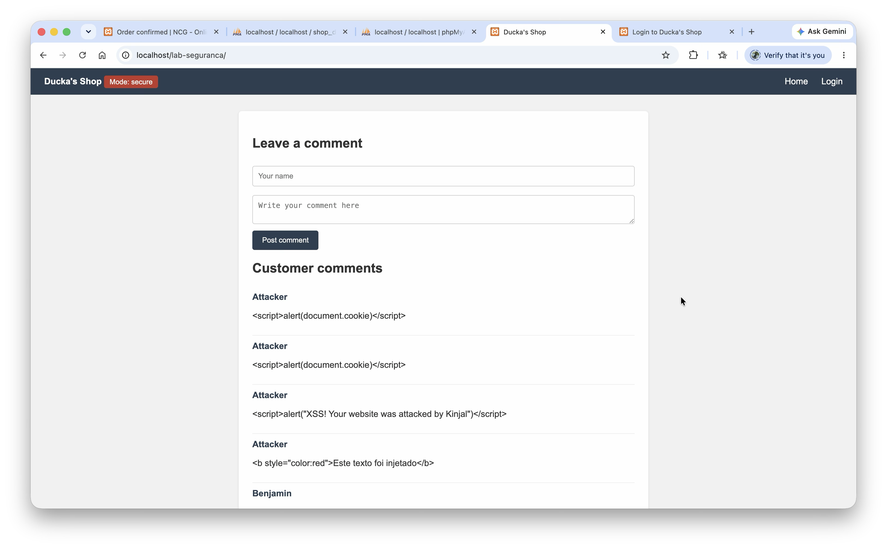
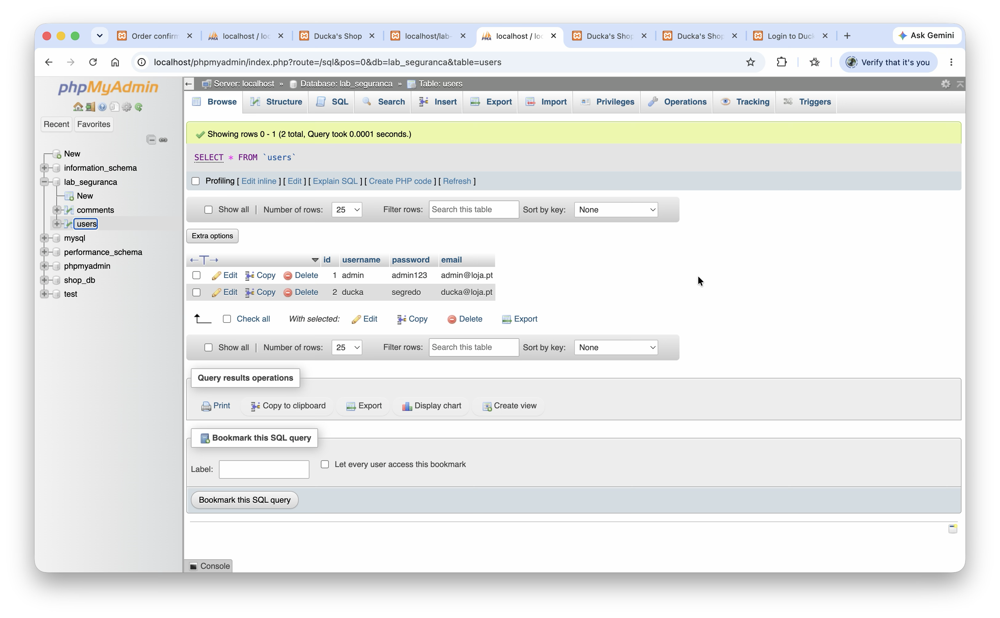
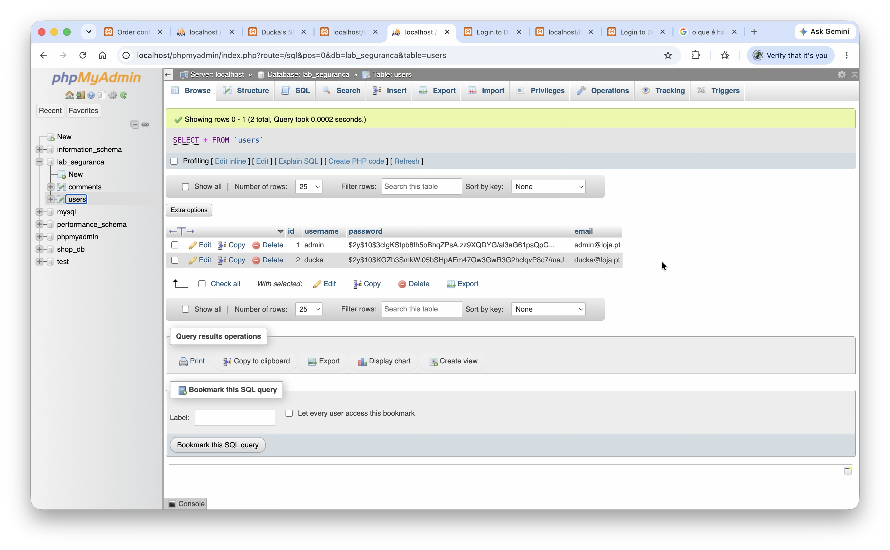

# Web Security Lab – Vulnerable vs Secure PHP Application

> ⚠️ **This application is deliberately vulnerable.** It was built for learning and must only be run locally. Never deploy it on a public server.

A small PHP/MySQL shop ("Ducka's Shop") built for my Professional Development portfolio (FdSc Computing, NCG Higher Education Centre). Every feature runs in a **vulnerable mode** and a **secure mode**, switched by a single `$mode` variable, so the same attack can be tested against both versions.



## What it demonstrates

| Vulnerability | Entry point | Vulnerable mode | Secure mode |
|---|---|---|---|
| SQL injection | Login (`login.php`) | User input inserted directly into the SQL query | Prepared statements |
| Stored XSS | Comments (`index.php`) | Comments printed as raw HTML | Output escaping with `htmlspecialchars()` |
| Weak authentication | `users` table | Passwords stored and compared in plain text | Hashing with `password_hash()` / `password_verify()` |

Comments are always saved with prepared statements, in both modes, so the comment box is used only to demonstrate XSS.

## Project structure

```
lab-seguranca/
├── config.php           # $mode switch and database connection
├── index.php            # shop home page and comment box (XSS)
├── login.php            # login form (SQL injection and password checking)
├── generate-hash.php    # one-off helper that prints UPDATE statements to hash the test passwords
├── reset.php            # removes injected comments and restores the demo comments
├── style.css
├── database/
│   └── lab_seguranca.sql
└── screenshots/
```

## Requirements

- [XAMPP](https://www.apachefriends.org/) (Apache, MariaDB/MySQL, PHP)
- A web browser

## Setup

1. Copy this folder into XAMPP's `htdocs` folder and name it `lab-seguranca`  
   (on macOS: `/Applications/XAMPP/xamppfiles/htdocs/lab-seguranca`).
2. Start **Apache** and **MySQL** in the XAMPP control panel.
3. Open phpMyAdmin at <http://localhost/phpmyadmin>, create a database called `lab_seguranca`, select it and import `database/lab_seguranca.sql`.
4. Open <http://localhost/lab-seguranca/> in the browser.

The connection in `config.php` uses XAMPP's default account (`root` with an empty password).

## Switching modes

Open `config.php` and set:

```php
$mode = 'vulnerable';   // or 'secure'
```

The current mode is shown in the top bar of every page.

## Test accounts

| Username | Password |
|---|---|
| admin | admin123 |
| ducka | segredo |

These are test values only. Once the passwords are hashed with `generate-hash.php`, the real passwords only work in secure mode, because vulnerable mode compares plain text. The SQL injection works either way.

## Example attacks

- **SQL injection (login):** username `admin`, password `' OR '1'='1`
- **Stored XSS (comments):** `<script>alert("XSS")</script>`

Both attacks succeed in vulnerable mode and are blocked in secure mode. Open `reset.php` to remove injected comments.

## Screenshots

| Vulnerable mode | Secure mode |
|---|---|
|  |  |
|  |  |
|  |  |

## Built with

PHP · MySQL/MariaDB · XAMPP · phpMyAdmin · Visual Studio Code

## References

- OWASP Foundation – [OWASP Top 10:2025](https://owasp.org/Top10/2025/)
- OWASP Foundation – [Cheat Sheet Series](https://cheatsheetseries.owasp.org/)

## Author

Alfredo Alexandre Da Costa
